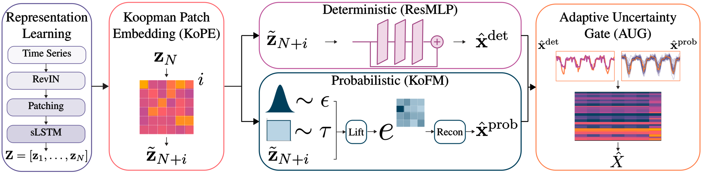
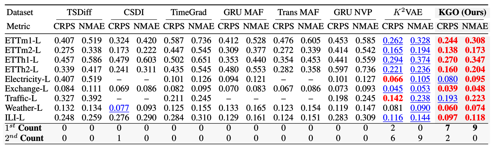
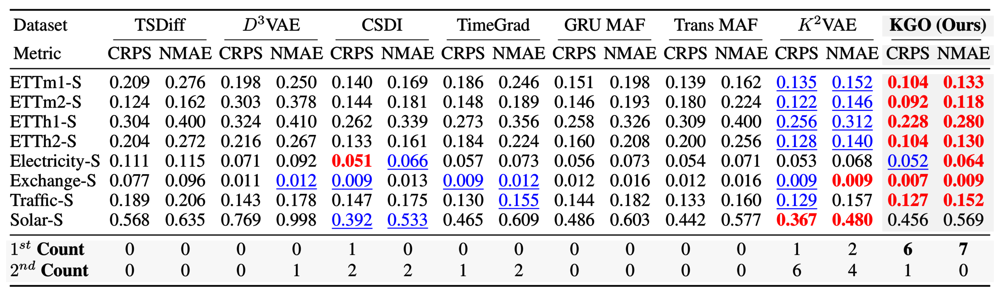
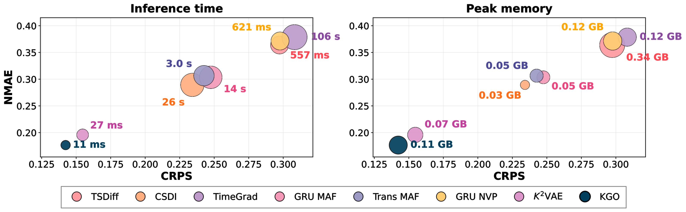

<div align="center">

<h1>Koopman Generative Operators for Efficient Probabilistic Time-Series Forecasting</h1>

<a href="https://neurips.cc/virtual/2026/loc/sydney/poster/153665"></a>
<a href="https://arxiv.org/abs/2611.04760"></a>
<a href="LICENSE"></a>


Official PyTorch implementation of **KGO** (**K**oopman **G**enerative **O**perators), NeurIPS 2026.



</div>

<br>

**KGO** bridges dynamical systems theory and modern generative modeling by combining Koopman operators with flow matching. A learned Koopman operator extrapolates the latent dynamics over the forecast horizon (KoPE); conditioned on this trajectory, a closed-form matrix exponential transports noise to forecasts in a single step (KoFM); and an adaptive gate allocates uncertainty to each variable and horizon according to how predictable it is (AUG). The result is an expressive predictive distribution without the iterative sampling of diffusion or standard flow-matching models.

## Results

On the ProbTS benchmark, KGO achieves the lowest **CRPS on 13 of 17** settings and the lowest **NMAE on 16 of 17** among the evaluated models. It is also the fastest model evaluated: **11 ms** per window for 100 trajectories, with 0.11 GB of peak GPU memory (single RTX 6000 Ada, averaged over the 36 long-term dataset–horizon pairs).

### Long-term forecasting

<div align="center">
  
</div>

### Short-term forecasting

<div align="center">
  
</div>

### Efficiency

<div align="center">
  
</div>
Bubble size = latency (left) / peak memory (right)

## Quick start

Requires an NVIDIA GPU and a CUDA toolkit with `nvcc`.

```bash
git clone https://github.com/azencot-group/KGO.git && cd KGO
conda create -n kgo python=3.10 -y && conda activate kgo
pip install -r requirements.txt
cd ProbTS
bash scripts/prepare_datasets.sh      # download datasets to ../datasets/
bash scripts/runner.sh etth1 96 0     # train + evaluate: dataset, horizon, seed
```

To reproduce the paper's tables and efficiency numbers, see [INSTRUCTIONS.md](INSTRUCTIONS.md).

## Citation

If you find this repo useful in your research, please consider citing our paper as follows:

```bibtex
@misc{marshanski2026kgo,
  title         = {Koopman Generative Operators for Efficient Probabilistic Time-Series Forecasting},
  author        = {Marshanski, Raz and Nochumsohn, Liran and Jauhari, Mayank and Oreshkin, Boris N. and Azencot, Omri},
  year          = {2026},
  eprint        = {2611.04760},
  archivePrefix = {arXiv},
  primaryClass  = {cs.LG},
  url           = {https://arxiv.org/abs/2611.04760}
}
```

## Acknowledgements

KGO builds on several open-source projects, and we thank their authors for making their code publicly available:

- [ProbTS](https://github.com/microsoft/probts): the training and evaluation framework and the benchmark protocol.
- [xLSTM](https://github.com/NX-AI/xlstm): the sLSTM encoder used for representation learning.
- [Sundial](https://github.com/thuml/Sundial): the AdaLN residual blocks adapted in KoFM.

## Contact

If you have any questions about the paper or the code, feel free to contact [Raz Marshanski](mailto:razmar@post.bgu.ac.il) or [Omri Azencot](mailto:azencot@bgu.ac.il).
